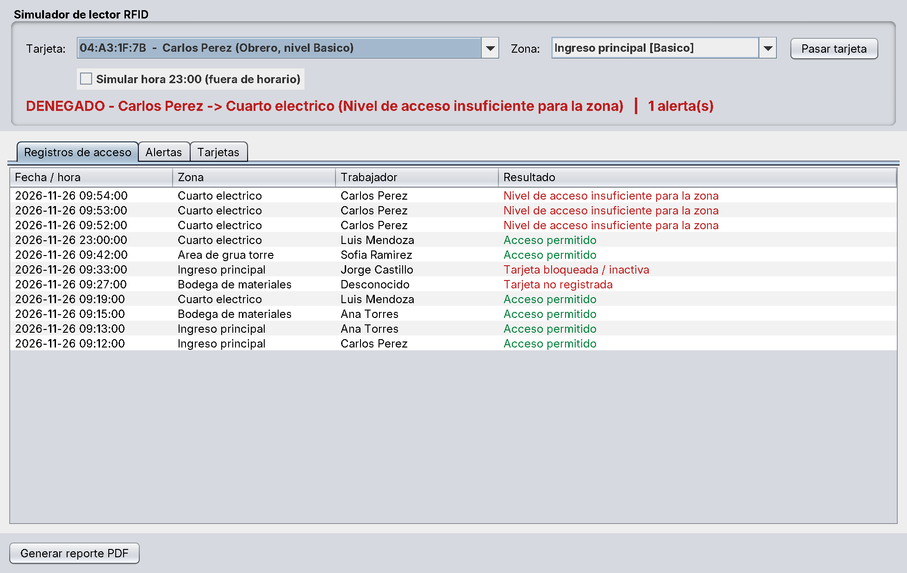
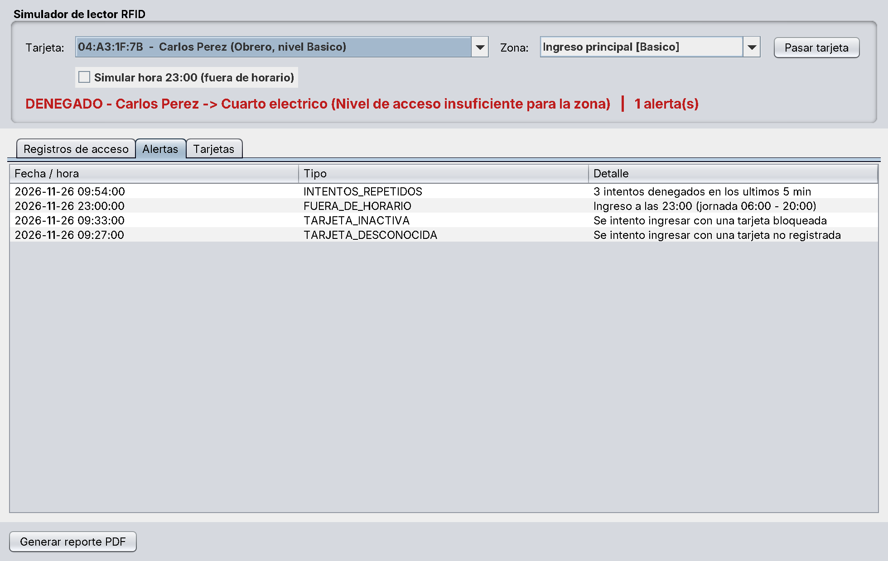
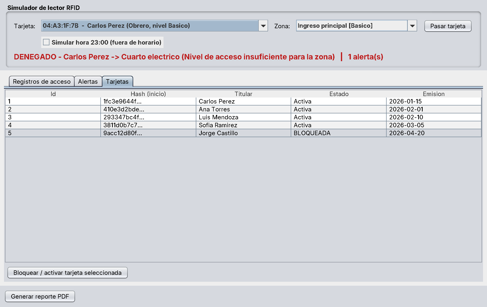
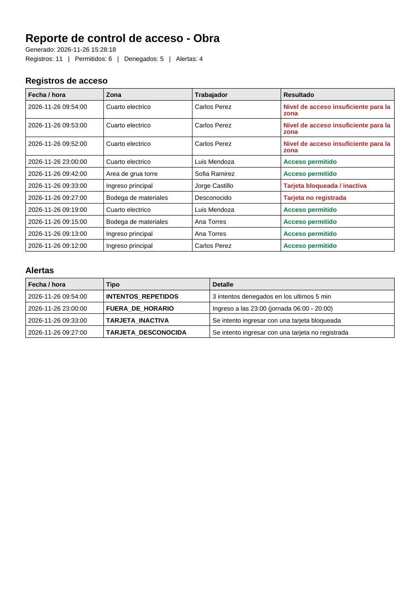
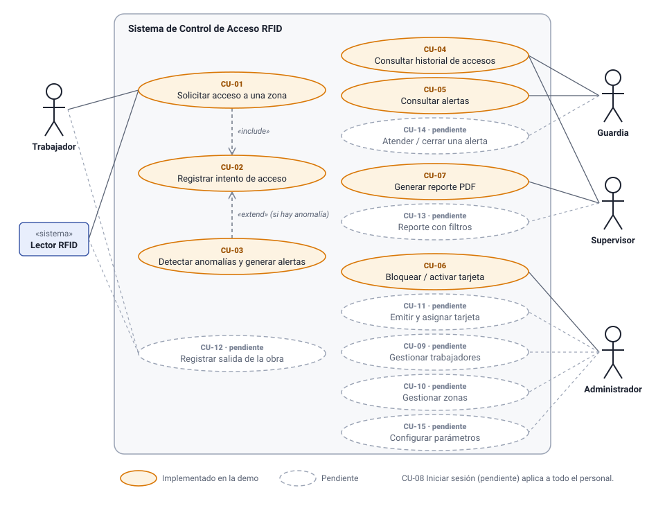

# Control-Acceso-RFID

Sistema de **control de acceso por tarjetas RFID para obras de construcción**, escrito en Java 21.
El proyecto nace como un reto para demostrar dominio de **Programación Orientada a Objetos (POO)** y del lenguaje Java.

> **Estado actual: DEMO / BETA.**
> Ya funciona el flujo completo: se "pasa" una tarjeta por un lector simulado, se decide si la persona entra, se guarda el registro, se detectan anomalías y se genera un reporte PDF.
> Es una base para seguir construyendo, no un producto terminado. La sección [Limitaciones de la demo](#11-limitaciones-de-la-demo) explica qué falta y la sección [Preguntas abiertas](#13-preguntas-abiertas-para-el-equipo) lo que todavía hay que decidir.

📖 **Documentación visual (GitHub Pages):** https://jacojean07.github.io/Control-Acceso-RFID/



<details>
<summary>Más capturas (alertas, tarjetas y reporte PDF)</summary>

| Alertas | Tarjetas |
|---|---|
|  |  |

**Reporte PDF** ([descargar ejemplo](docs/img/reporte-ejemplo.pdf)):



</details>

---

## Índice

1. [Qué hace el sistema](#1-qué-hace-el-sistema)
2. [Cómo ejecutarlo](#2-cómo-ejecutarlo)
3. [Guion para probar la demo](#3-guion-para-probar-la-demo)
4. [Arquitectura](#4-arquitectura)
5. [Flujo de una lectura, paso a paso](#5-flujo-de-una-lectura-paso-a-paso)
6. [Estructura de carpetas](#6-estructura-de-carpetas)
7. [Explicación de cada archivo](#7-explicación-de-cada-archivo)
8. [Base de datos](#8-base-de-datos)
9. [Cambios realizados y a qué afectan](#9-cambios-realizados-y-a-qué-afectan)
10. [Decisiones de diseño (y por qué)](#10-decisiones-de-diseño-y-por-qué)
11. [Limitaciones de la demo](#11-limitaciones-de-la-demo)
12. [Cómo extender el proyecto](#12-cómo-extender-el-proyecto)
13. [Preguntas abiertas para el equipo](#13-preguntas-abiertas-para-el-equipo)
14. [Convenciones del código](#14-convenciones-del-código)
15. [Casos de uso](#15-casos-de-uso)
16. [Posibles mejoras](#16-posibles-mejoras)

---

## 1. Qué hace el sistema

En una obra hay zonas con distinto nivel de riesgo (ingreso, bodega, grúa, cuarto eléctrico). Cada trabajador tiene una tarjeta RFID y un **nivel de acceso**. En la puerta de cada zona hay un lector.

Cuando alguien acerca su tarjeta:

1. El sistema identifica la tarjeta (sin guardar nunca el código real de la tarjeta, solo su *hash*).
2. Decide si **permite** o **deniega** el acceso y por qué.
3. Guarda un **registro** del intento (exitoso o no).
4. Revisa si hay algo raro y, si lo hay, genera **alertas**:
   - tarjeta no registrada,
   - tarjeta bloqueada,
   - 3 o más intentos fallidos en 5 minutos con la misma tarjeta,
   - acceso permitido fuera del horario laboral (06:00–20:00).
5. Permite generar un **reporte PDF** con los registros y las alertas.

El detalle de cada funcionalidad, como caso de uso, está en la [sección 15](#15-casos-de-uso) y en [`docs/CASOS_DE_USO.md`](docs/CASOS_DE_USO.md).

**Funcionalidades de la demo:**

| Funcionalidad | Dónde se ve |
|---|---|
| Simular el paso de una tarjeta por cualquier zona | Panel superior de la ventana / opción 1 en consola |
| Simular una lectura a las 23:00 (para probar la alerta de horario) | Casilla "Simular hora 23:00" |
| Simular una tarjeta desconocida | Última opción del combo de tarjetas |
| Historial de accesos (verde = permitido, rojo = denegado) | Pestaña "Registros de acceso" |
| Alertas generadas | Pestaña "Alertas" |
| Bloquear / activar tarjetas | Pestaña "Tarjetas" |
| Reporte PDF | Botón "Generar reporte PDF" (se guarda en `reportes/`) |
| Modo texto | `--consola` |

---

## 2. Cómo ejecutarlo

**Requisitos:** JDK 21. Maven 3.9+ si se usa la terminal (Eclipse ya trae Maven integrado).
**No hace falta instalar una base de datos**: se usa H2 en memoria, que se crea al arrancar y se borra al cerrar.

### Opción A: Eclipse

1. `File → Import → Maven → Existing Maven Projects` y elegir la carpeta del repo
   (o, si ya estaba importado, clic derecho al proyecto → `Maven → Update Project...` para que descargue las dependencias nuevas).
2. Abrir `src/main/java/com/shadow/controlacceso/Main.java` → `Run As → Java Application`.

Para el modo consola: `Run Configurations → Arguments → Program arguments: --consola`.

### Opción B: terminal con Maven

```bash
mvn compile exec:java                                # abre la ventana
mvn compile exec:java -Dexec.args="--consola"        # modo texto
mvn test                                             # corre las pruebas
```

### Opción C: jar ejecutable

```bash
mvn package
java -jar target/control-acceso-obras-0.0.1-SNAPSHOT.jar
java -jar target/control-acceso-obras-0.0.1-SNAPSHOT.jar --consola
```

`mvn package` genera un "fat jar" (con H2 y OpenPDF incluidos), así que ese único archivo se puede copiar a otra máquina con Java 21 y ejecutarse.

> Si no hay pantalla disponible (por ejemplo, en un servidor), `Main` cambia solo a modo consola.

---

## 3. Guion para probar la demo

Datos precargados (`src/main/resources/seed.sql`):

**Trabajadores y tarjetas**

| UID de la tarjeta | Trabajador | Rol | Nivel | Estado tarjeta |
|---|---|---|---|---|
| `04:A3:1F:7B` | Carlos Perez | Obrero | Básico | Activa |
| `04:B7:22:9C` | Ana Torres | Operador de maquinaria | Restringido | Activa |
| `04:C1:5E:03` | Luis Mendoza | Electricista | Crítico | Activa |
| `04:D9:8A:44` | Sofia Ramirez | Supervisor | Crítico | Activa |
| `04:E2:10:F5` | Jorge Castillo | Visitante | Básico | **Bloqueada** |

**Zonas**

| Código | Zona | Nivel requerido |
|---|---|---|
| `Z-ING` | Ingreso principal | Básico |
| `Z-BOD` | Bodega de materiales | Restringido |
| `Z-GRU` | Área de grúa torre | Crítico |
| `Z-ELE` | Cuarto eléctrico | Crítico |

**Escenarios para probar:**

| # | Acción | Resultado esperado |
|---|---|---|
| 1 | Carlos → Ingreso principal | ✅ Permitido |
| 2 | Carlos → Cuarto eléctrico | ❌ Nivel insuficiente |
| 3 | Repetir el paso 2 tres veces seguidas | ❌ + alerta `INTENTOS_REPETIDOS` |
| 4 | Jorge → Ingreso principal | ❌ Tarjeta bloqueada + alerta `TARJETA_INACTIVA` |
| 5 | "Tarjeta desconocida" → cualquier zona | ❌ + alerta `TARJETA_DESCONOCIDA` |
| 6 | Luis → Cuarto eléctrico con "Simular hora 23:00" marcado | ✅ Permitido + alerta `FUERA_DE_HORARIO` |
| 7 | Pestaña Tarjetas → bloquear la de Carlos → repetir el paso 1 | ❌ Tarjeta bloqueada |
| 8 | Botón "Generar reporte PDF" | Se crea `reportes/reporte-AAAAMMDD-HHMMSS.pdf` y se abre |

---

## 4. Arquitectura

Es una **arquitectura en capas**: cada capa solo conoce a la de abajo, y siempre a través de **interfaces**.

```
┌──────────────────────────────────────────────────────────────────┐
│  PRESENTACIÓN (ui)             VentanaPrincipal  /  ConsolaApp     │
│  Muestra datos y captura acciones. No contiene reglas de negocio.  │
└───────────────┬──────────────────────────────────┬────────────────┘
                │ usa                              │ escucha
┌───────────────▼──────────────────┐   ┌───────────▼────────────────┐
│  SERVICIOS (service)             │   │  HARDWARE (reader)         │
│  ControlAccesoService            │   │  LectorRFID  «interfaz»    │
│  DetectorAnomalias               │   │   └ SimuladorLectorRFID    │
│  CriptoService                   │   └────────────────────────────┘
│  ReporteService ──────────────────────► ReporteGenerator «interfaz»
│  Reglas de negocio               │        └ PdfReporteGenerator  │
└───────────────┬──────────────────┘          (report)
                │ usa (solo interfaces)
┌───────────────▼──────────────────────────────────────────────────┐
│  PERSISTENCIA (repository)                                        │
│  TrabajadorRepository, TarjetaRepository, ZonaRepository,         │
│  RegistroRepository, AlertaRepository        «interfaces»         │
│        ▲ implementadas por                                        │
│  repository/jdbc: Jdbc*Repository  +  ConexionDB  ──► H2 (SQL)    │
└──────────────────────────────────────────────────────────────────┘

        MODELO (model): Trabajador, TarjetaRFID, Zona, RegistroAcceso, Alerta + enums
        Lo usan todas las capas. No depende de nadie.

        CONFIGURACIÓN (config): AppConfig crea todos los objetos y los conecta.
```

### Patrones y principios aplicados

| Patrón / principio | Dónde | Para qué |
|---|---|---|
| **Arquitectura en capas** | Paquetes `ui`, `service`, `repository`, `model` | Separar responsabilidades: cambiar la UI no toca la lógica, cambiar la BD no toca los servicios. |
| **Repository** | `repository/*Repository` + `repository/jdbc/*` | Esconder el SQL detrás de interfaces. Los servicios piden "buscar tarjeta por hash" sin saber que existe JDBC. |
| **Inyección de dependencias (manual)** | Constructores de servicios + `AppConfig` | Cada clase recibe lo que necesita; no hace `new` de sus dependencias. Esto permite probar y reemplazar piezas. |
| **Composition Root** | `AppConfig` | Único lugar donde se eligen las implementaciones concretas (H2, PDF, simulador). |
| **Strategy** | `ReporteGenerator` → `PdfReporteGenerator` | Cambiar el formato del reporte sin tocar `ReporteService`. |
| **Observer** | `LectorRFID.setOyente(...)` | El lector avisa cuando lee una tarjeta, en vez de que alguien le pregunte todo el tiempo. |
| **Inversión de dependencias (la D de SOLID)** | Servicios → interfaces | Los módulos de alto nivel (servicios) no dependen de los de bajo nivel (JDBC, OpenPDF). |
| **Entidades vs. eventos** | Clases (`Trabajador`, `TarjetaRFID`, `Zona`) y `record` (`RegistroAcceso`, `Alerta`) | Las entidades cambian con el tiempo; los eventos son históricos e inmutables. |

---

## 5. Flujo de una lectura, paso a paso

Qué pasa cuando en la ventana se presiona **"Pasar tarjeta"**:

```
VentanaPrincipal.pasarTarjeta()
   │  toma la tarjeta y la zona elegidas en los combos
   ▼
SimuladorLectorRFID.simularLectura(uid, "Z-BOD", ahora)
   │  crea un LecturaRFID(uid, zona, fechaHora) y avisa al oyente
   ▼
(oyente registrado por la ventana)  →  ControlAccesoService.procesarLectura(lectura)
   │
   ├─ 1. ZonaRepository.buscarPorCodigo("Z-BOD")          → Zona (o error si no existe)
   ├─ 2. CriptoService.hashUid(uid)                       → "410e3d2b..." (SHA-256)
   ├─ 3. TarjetaRepository.buscarPorUidHash(hash)         → Optional<TarjetaRFID>
   ├─ 4. TrabajadorRepository.buscarPorId(...)            → Optional<Trabajador>
   ├─ 5. evaluar(...)   reglas en orden, el primer "no" gana:
   │        ¿existe la tarjeta?  no → DENEGADO_TARJETA_DESCONOCIDA
   │        ¿está activa?        no → DENEGADO_TARJETA_INACTIVA
   │        ¿nivel suficiente?   no → DENEGADO_NIVEL_INSUFICIENTE
   │        si pasa todo            → PERMITIDO
   ├─ 6. RegistroRepository.guardar(registro)             → registro con id
   ├─ 7. DetectorAnomalias.analizar(registro)             → List<Alerta>
   └─ 8. AlertaRepository.guardar(cada alerta)
   ▼
ResultadoLectura (registro + trabajador + zona + alertas)
   ▼
VentanaPrincipal.mostrarResultado(...)  → texto verde/rojo + refresca las tablas
```

La consola (`ConsolaApp`) hace exactamente lo mismo; solo cambia cómo se muestra el resultado.

---

## 6. Estructura de carpetas

```
Control-Acceso-RFID/
├── pom.xml                         Dependencias y plugins de Maven
├── README.md                       Este documento
├── LICENSE                         GPL-3.0
├── .gitignore                      Ignora target/, reportes/, archivos de IDE
├── .project, .classpath, .settings/   Configuración de Eclipse (se mantienen, ver §9)
├── docs/                          Sitio de GitHub Pages (index.html), CASOS_DE_USO.md y capturas en docs/img/
└── src/
    ├── main/
    │   ├── java/com/shadow/controlacceso/
    │   │   ├── Main.java                         Punto de entrada
    │   │   ├── config/
    │   │   │   └── AppConfig.java                Arma y conecta todos los objetos
    │   │   ├── model/                            Clases del dominio
    │   │   │   ├── Trabajador.java
    │   │   │   ├── TarjetaRFID.java
    │   │   │   ├── Zona.java
    │   │   │   ├── RegistroAcceso.java           (record)
    │   │   │   ├── Alerta.java                   (record)
    │   │   │   └── enums/
    │   │   │       ├── Nivel.java
    │   │   │       ├── Rol.java
    │   │   │       ├── Resultado.java
    │   │   │       └── TipoAlerta.java
    │   │   ├── reader/                           Lectores RFID
    │   │   │   ├── LectorRFID.java               (interfaz)
    │   │   │   ├── LecturaRFID.java              (record)        ← NUEVO
    │   │   │   └── SimuladorLectorRFID.java
    │   │   ├── repository/                       Contratos de acceso a datos
    │   │   │   ├── TrabajadorRepository.java
    │   │   │   ├── TarjetaRepository.java
    │   │   │   ├── ZonaRepository.java                           ← NUEVO
    │   │   │   ├── RegistroRepository.java
    │   │   │   ├── AlertaRepository.java
    │   │   │   └── jdbc/                         Implementación con JDBC
    │   │   │       ├── ConexionDB.java
    │   │   │       ├── DatosAccesoException.java                 ← NUEVO
    │   │   │       ├── JdbcTrabajadorRepository.java
    │   │   │       ├── JdbcTarjetaRepository.java
    │   │   │       ├── JdbcZonaRepository.java                   ← NUEVO
    │   │   │       ├── JdbcRegistroRepository.java
    │   │   │       └── JdbcAlertaRepository.java
    │   │   ├── service/                          Lógica de negocio
    │   │   │   ├── ControlAccesoService.java
    │   │   │   ├── DetectorAnomalias.java
    │   │   │   ├── CriptoService.java
    │   │   │   ├── ReporteService.java
    │   │   │   └── ResultadoLectura.java         (record)        ← NUEVO
    │   │   ├── report/                           Generación de reportes
    │   │   │   ├── ReporteGenerator.java         (interfaz)      ← NUEVO
    │   │   │   ├── PdfReporteGenerator.java
    │   │   │   ├── DatosReporte.java             (record)        ← NUEVO
    │   │   │   └── FilaRegistro.java             (record)        ← NUEVO
    │   │   └── ui/                               Interfaces de usuario
    │   │       ├── VentanaPrincipal.java         (Swing)         ← NUEVO
    │   │       └── ConsolaApp.java               (texto)
    │   └── resources/
    │       ├── schema.sql                        Creación de tablas
    │       └── seed.sql                          Datos de prueba
    └── test/java/com/shadow/controlacceso/                       ← NUEVO
        ├── service/ControlAccesoServiceTest.java
        └── report/PdfReporteGeneratorTest.java
```

---

## 7. Explicación de cada archivo

### 7.1 `Main` y `config`

**`Main.java`**: arranca todo.
1. Crea `AppConfig` (que construye todos los objetos).
2. Inicializa la base de datos (tablas + datos de prueba).
3. Abre la ventana Swing, o la consola si se pasó `--consola` o no hay pantalla.

La ventana se crea con `SwingUtilities.invokeLater(...)` porque Swing exige que toda la interfaz se maneje desde su propio hilo (el *Event Dispatch Thread*).

**`config/AppConfig.java`**: la "raíz de composición". Hace dos cosas:
- **Guarda los parámetros** de la demo como constantes: URL de la BD, umbral de intentos (3), ventana de tiempo (5 min), horario laboral (06:00–20:00) y carpeta de reportes.
- **Construye el grafo de objetos** en orden: `ConexionDB` → repositorios JDBC → `CriptoService` y `DetectorAnomalias` → `ControlAccesoService` y `ReporteService` → simulador del lector.

Tiene un segundo constructor `AppConfig(String url)` que usan los tests para trabajar cada uno con una BD limpia.

> **Afecta a:** todo. Si se cambia una implementación (por ejemplo, MySQL en lugar de H2 o CSV en lugar de PDF), **este es el único archivo que hay que tocar**.

### 7.2 `model`: el dominio

| Clase | Tipo | Qué representa | Detalles importantes |
|---|---|---|---|
| `Trabajador` | clase | Persona de la obra | Valida en el constructor que cédula y nombre no estén vacíos. Contiene la regla `puedeIngresarA(Zona)`. Dos trabajadores son iguales si tienen la misma **cédula** (`equals`/`hashCode`). |
| `TarjetaRFID` | clase | Tarjeta física asignada a un trabajador | Guarda `uidHash`, **no el UID**. Tiene `bloquear()` / `activar()` y `getHashCorto()` para mostrarla en pantalla. |
| `Zona` | clase | Área protegida por un lector | `codigo` (ej. `Z-BOD`) es lo que "conoce" el lector instalado en la puerta. Su `toString()` se usa directamente en el combo de la ventana. |
| `RegistroAcceso` | `record` | Un intento de acceso | Inmutable. `tarjetaId` es `null` si la tarjeta era desconocida. `conId(...)` devuelve una copia con el id que asignó la BD. |
| `Alerta` | `record` | Anomalía detectada | Inmutable. Apunta al registro que la provocó (`registroId`). |

**Enums (`model/enums`)**

| Enum | Valores | Comentario |
|---|---|---|
| `Nivel` | `BASICO(1)`, `RESTRINGIDO(2)`, `CRITICO(3)` | El nivel del trabajador debe **alcanzar** el de la zona (`alcanza()`). El peso es explícito para que reordenar el enum no cambie las reglas. |
| `Rol` | Obrero, Operador de maquinaria, Electricista, Supervisor, Visitante | Por ahora es **solo informativo**: el permiso lo da el `Nivel`. |
| `Resultado` | `PERMITIDO` + un `DENEGADO_*` por cada motivo | Así cada registro explica por qué se negó el acceso. `esPermitido()` evita comparar a mano. |
| `TipoAlerta` | `TARJETA_DESCONOCIDA`, `TARJETA_INACTIVA`, `INTENTOS_REPETIDOS`, `FUERA_DE_HORARIO` | Uno por cada regla del detector. |

### 7.3 `reader`: lectores RFID

- **`LectorRFID`** (interfaz): define `setOyente(Consumer<LecturaRFID>)` y `getNombre()`. Cualquier lector, simulado o real, cumple este contrato.
- **`LecturaRFID`** (record): lo que entrega el lector, es decir el UID leído, el código de la zona y la fecha y hora.
- **`SimuladorLectorRFID`**: implementación de prueba.
  - `UIDS_DEMO` contiene los UIDs "impresos" en las tarjetas de demo (coinciden con `seed.sql`).
  - `simularLectura(uid, zona)` y `simularLectura(uid, zona, fechaHora)` disparan el oyente.
  - `generarUidAleatorio()` sirve para probar tarjetas desconocidas.

> **Afecta a:** el día que haya hardware real se crea otra clase (por ejemplo, `LectorSerialRFID`) que implemente `LectorRFID`, y se cambia una línea en `AppConfig`.

### 7.4 `repository`: acceso a datos

**Interfaces (los contratos):**

| Interfaz | Métodos |
|---|---|
| `TrabajadorRepository` | `buscarPorId`, `listarTodos` |
| `TarjetaRepository` | `buscarPorUidHash`, `listarTodas`, `actualizarEstado` |
| `ZonaRepository` | `buscarPorId`, `buscarPorCodigo`, `listarTodas` |
| `RegistroRepository` | `guardar`, `listarRecientes`, `contarDenegadosDesde` |
| `AlertaRepository` | `guardar`, `listarRecientes` |

Las búsquedas devuelven `Optional<T>` en lugar de `null`, para obligar a quien llama a manejar el caso "no existe".

**Implementación JDBC (`repository/jdbc`):**

- **`ConexionDB`**: fábrica de conexiones.
  - `abrir()` entrega una **conexión nueva** cada vez; el repositorio la cierra con *try-with-resources* (ver [§10](#10-decisiones-de-diseño-y-por-qué)).
  - `inicializar()` ejecuta `schema.sql` y `seed.sql` (quita los comentarios `--` y separa las sentencias por `;`).
- **`Jdbc*Repository`**: todas siguen el mismo esquema:
  ```java
  try (Connection cn = conexionDB.abrir();
       PreparedStatement ps = cn.prepareStatement(SQL)) {
      ps.setXxx(1, valor);          // siempre parámetros "?", nunca concatenar → evita SQL injection
      try (ResultSet rs = ps.executeQuery()) {
          ... mapear(rs) ...        // fila → objeto del modelo
      }
  } catch (SQLException e) {
      throw new DatosAccesoException("mensaje", e);
  }
  ```
  - Los enums se guardan como texto (`Rol.name()`) y se leen con `Rol.valueOf(...)`.
  - `guardar(...)` usa `RETURN_GENERATED_KEYS` para obtener el id autoincremental.
  - `JdbcRegistroRepository.mapear` usa `rs.wasNull()` **justo después** de `getLong("tarjeta_id")`, porque `getLong` devuelve `0` cuando la columna es `NULL`.
  - `JdbcZonaRepository` muestra un truco: una mini interfaz funcional `Parametros` para reutilizar el método `buscarUno` con lambdas.
- **`DatosAccesoException`**: convierte la `SQLException` (que es *checked*, es decir, obliga a capturarla) en una excepción no comprobada. Así las interfaces de repositorio no quedan atadas a JDBC.

### 7.5 `service`: lógica de negocio

- **`ControlAccesoService`**: el corazón. `procesarLectura(LecturaRFID)` implementa el flujo de la [§5](#5-flujo-de-una-lectura-paso-a-paso). También ofrece consultas para la UI: `buscarTitular(uid)`, `listarZonas()`, `listarTarjetas()`, `buscarTrabajador(id)` y `alternarEstadoTarjeta(tarjeta)`.
- **`DetectorAnomalias`**: recibe un registro ya guardado y **devuelve** las alertas que correspondan, **sin guardarlas** (las guarda `ControlAccesoService`). Las cuatro reglas están en `analizar(...)`. Sus parámetros (umbral, ventana y horario) llegan por constructor desde `AppConfig`.
- **`CriptoService`**:
  - `normalizarUid("04:a3:1f:7b")` devuelve `"04A31F7B"`, así acepta el UID con o sin `:`, espacios o minúsculas.
  - `hashUid(uid)` devuelve el SHA-256 en hexadecimal (64 caracteres).
  - `enmascararUid(uid)` devuelve `"04:A3:**:**"`, para logs (todavía no se usa en la UI).
- **`ReporteService`**:
  - `registrosDetallados(limite)` convierte ids en nombres. Carga zonas, tarjetas y trabajadores **una sola vez** en mapas, en vez de hacer una consulta por cada fila (el problema conocido como "N+1").
  - `alertasRecientes(limite)`.
  - `generarReporte(carpeta, limite)` arma un `DatosReporte` y se lo pasa al `ReporteGenerator` inyectado. El nombre del archivo lleva fecha y hora.
- **`ResultadoLectura`** (record): lo que devuelve `procesarLectura`, con `permitido()` y `mensaje()` para la UI.

### 7.6 `report`: reportes

- **`ReporteGenerator`** (interfaz): `getExtension()` y `generar(DatosReporte, OutputStream)`.
- **`PdfReporteGenerator`**: implementación con **OpenPDF**. Genera un título, un resumen (totales), una tabla de registros con el resultado coloreado y una tabla de alertas. Los encabezados se repiten en cada página.
- **`DatosReporte`** (record): todo lo que necesita un generador, ya preparado. **El generador no consulta la BD.**
- **`FilaRegistro`** (record): un registro "para mostrar", con nombres en lugar de ids. Lo usan tanto la tabla de la ventana como el PDF.

### 7.7 `ui`: interfaces de usuario

- **`VentanaPrincipal`** (Swing, look & feel *Nimbus*):
  - Panel superior con el simulador: combo de tarjetas (cada UID con el nombre de su titular), combo de zonas, casilla de horario nocturno, botón y resultado en verde o rojo.
  - Tres pestañas: Registros (con un *renderer* que colorea la columna Resultado), Alertas y Tarjetas (con botón para bloquear o activar).
  - Botón para generar el PDF, que se abre con el visor del sistema si está disponible.
  - Al construirse registra el **oyente** del lector: `lector.setOyente(l -> mostrarResultado(controlAcceso.procesarLectura(l)))`.
- **`ConsolaApp`**: menú de texto con las mismas operaciones. Se usa para probar rápido o en máquinas sin pantalla.

### 7.8 `resources`

- **`schema.sql`**: crea las 5 tablas y un índice (ver [§8](#8-base-de-datos)).
- **`seed.sql`**: carga 5 trabajadores, 4 zonas y 5 tarjetas. Las tarjetas se enlazan con su trabajador por cédula (`SELECT id FROM trabajador WHERE cedula = ...`), sin escribir ids a mano.

### 7.9 Tests (`src/test`)

| Test | Qué comprueba |
|---|---|
| `permiteAccesoConNivelSuficiente` | Carlos entra al ingreso |
| `aceptaElUidEnCualquierFormato` | `04a31f7b` = `04:A3:1F:7B` |
| `niegaAccesoConNivelInsuficiente` | Carlos no entra al cuarto eléctrico |
| `tarjetaDesconocidaSeNiegaYGeneraAlerta` | UID inventado → denegado + alerta |
| `tarjetaBloqueadaSeNiega` | Jorge → denegado + alerta |
| `tresIntentosFallidosGeneranAlertaDeIntentosRepetidos` | Tercer fallo → alerta |
| `accesoNocturnoSePermitePeroGeneraAlerta` | 23:00 → permitido + alerta |
| `bloquearUnaTarjetaImpideElAcceso` | Bloquear y luego intentar entrar → denegado |
| `elHistorialMuestraNombresYDesconocidos` | `ReporteService` traduce ids a nombres |
| `zonaInexistenteLanzaExcepcion` | Zona inválida → `IllegalArgumentException` |
| `PdfReporteGeneratorTest.generaUnPdfValido` | El archivo empieza con `%PDF-` |

Cada test de servicio usa una BD en memoria **nueva** (con nombre aleatorio), así que los tests no se afectan entre sí.

---

## 8. Base de datos

Motor: **H2 en memoria** (`jdbc:h2:mem:controlacceso;DB_CLOSE_DELAY=-1`).
`DB_CLOSE_DELAY=-1` hace que la BD siga viva aunque se cierren todas las conexiones, y se borra al terminar el programa.

```
 trabajador                  tarjeta_rfid                      zona
┌─────────────────┐        ┌──────────────────────┐        ┌───────────────────┐
│ id (PK)         │◄───────┤ trabajador_id (FK)   │        │ id (PK)           │
│ cedula (UNIQUE) │  1   N │ id (PK)              │        │ codigo (UNIQUE)   │
│ nombre          │        │ uid_hash (UNIQUE)    │        │ nombre            │
│ rol             │        │ activa               │        │ nivel_requerido   │
│ nivel_acceso    │        │ fecha_emision        │        └─────────▲─────────┘
└─────────────────┘        └──────────▲───────────┘                  │
                                      │ 0..1                         │ 1
                           ┌──────────┴───────────────────────────────┴─┐
                           │ registro_acceso                            │
                           │ id (PK), uid_hash, tarjeta_id (FK, NULL),  │
                           │ zona_id (FK), fecha_hora, resultado        │
                           └──────────▲─────────────────────────────────┘
                                      │ 1
                           ┌──────────┴─────────────┐
                           │ alerta                 │
                           │ id (PK), tipo, mensaje,│
                           │ fecha_hora, registro_id│
                           └────────────────────────┘
```

- `registro_acceso.uid_hash` se guarda **aunque la tarjeta no exista**, para poder contar intentos repetidos de una tarjeta desconocida.
- El índice `idx_registro_uid_fecha (uid_hash, fecha_hora)` acelera la consulta de intentos fallidos recientes.
- Un trabajador **puede tener varias tarjetas** (relación 1:N), por ejemplo cuando pierde una y le dan otra.

---

## 9. Cambios realizados y a qué afectan

Antes de estos cambios, el repositorio tenía **la estructura de carpetas con los 30 archivos vacíos** (0 bytes), un `pom.xml` sin dependencias útiles y la carpeta `target/` subida a Git.

| Cambio | Archivos | A qué afecta / por qué |
|---|---|---|
| Implementación de todas las clases existentes | Todos los `.java` y `.sql` que estaban vacíos | Respetando los nombres y paquetes que ya había definido el autor. |
| **`ConexionDB` entrega una conexión nueva por operación** | `ConexionDB`, todos los `Jdbc*Repository` | No hay una conexión global compartida: cada operación abre la suya y la cierra con *try-with-resources*. Más seguro con varios hilos (UI y lectores) y sin conexiones "colgadas". Si se necesita rendimiento, se mete un pool dentro de `ConexionDB` sin tocar nada más. |
| **`ReporteGenerator` como interfaz** | `report/ReporteGenerator` (nuevo), `PdfReporteGenerator`, `ReporteService`, `AppConfig` | `ReporteService` ya no depende de PDF. Agregar CSV o Excel = crear una clase nueva y cambiar una línea en `AppConfig`. |
| **`ZonaRepository` + `JdbcZonaRepository`** | Nuevos | Existía el modelo `Zona` pero no había forma de leerla de la BD. Sin zonas no se puede validar un acceso. |
| `Nivel` queda **solo como nivel de acceso** | `Nivel` | Antes era ambiguo (¿nivel de acceso o severidad de alerta?). La severidad se puede agregar luego a `TipoAlerta` si se necesita. |
| `LecturaRFID` (nuevo record) | `reader/` | Une en un solo objeto el UID, la zona y la hora que entrega un lector. |
| `ResultadoLectura`, `DatosReporte`, `FilaRegistro` (nuevos records) | `service/`, `report/` | Objetos para transportar datos entre capas sin exponer detalles internos. |
| `DatosAccesoException` (nueva) | `repository/jdbc/` | Evita que `SQLException` "contamine" las interfaces de repositorio y los servicios. |
| `VentanaPrincipal` (nueva, Swing) | `ui/` | La UI gráfica de la demo. `ConsolaApp` se mantiene como alternativa. |
| Tests | `src/test/...` (nuevo) | 11 pruebas con JUnit 5 que cubren las reglas de acceso, las alertas y el PDF. |
| `pom.xml` | `pom.xml` | Se agregó **H2** (BD embebida), **OpenPDF** (PDF), `exec-maven-plugin` (`mvn exec:java`) y `maven-shade-plugin` (jar ejecutable con dependencias). |
| `.gitignore` y quitar `target/` de Git | `.gitignore`, `target/` | `target/` se regenera al compilar y no debe versionarse (tenía incluso una ruta absoluta de la máquina del autor y una clase `App` que ya no existe). También se ignora `reportes/`. |
| Archivos de Eclipse **se mantienen** | `.project`, `.classpath`, `.settings/` | No se borraron para no romperle el proyecto a quien ya lo tiene abierto en Eclipse. Lo ideal a futuro es ignorarlos también (Eclipse los regenera al importar el proyecto como Maven). |

---

## 10. Decisiones de diseño (y por qué)

**¿Por qué guardar el hash y no el UID?**
El UID es lo que se necesita para clonar una tarjeta. Si alguien obtiene la base de datos, solo ve hashes. El lector entrega el UID, se calcula el hash en memoria y se busca por hash.
*Mejora pendiente:* usar **HMAC-SHA256 con una clave secreta** en lugar de SHA-256 simple. Como los UIDs son cortos (4 a 7 bytes), un SHA-256 sin clave podría romperse por fuerza bruta.

**¿Por qué una conexión nueva por operación?**
Una única `Connection` abierta y compartida tiene varios problemas: no es segura entre hilos, se puede caer (timeout del servidor) y nadie sabe cuándo cerrarla. Abrir y cerrar con *try-with-resources* es el patrón estándar de JDBC. Con H2 en memoria el costo es mínimo; con MySQL se agregaría un pool (HikariCP) **dentro** de `ConexionDB`.

**¿Por qué clases para unas cosas y `record` para otras?**
`Trabajador`, `TarjetaRFID` y `Zona` son **entidades**: tienen identidad y pueden cambiar (una tarjeta se bloquea). `RegistroAcceso` y `Alerta` son **eventos históricos**: lo que pasó no cambia, así que son inmutables.

**¿Por qué `Resultado` tiene varios `DENEGADO_*`?**
Para que el historial y el reporte expliquen el **motivo** del rechazo, y para que el detector de anomalías pueda reaccionar distinto según el caso.

**¿Por qué el detector no guarda las alertas?**
Para que tenga una sola responsabilidad (decidir) y sea fácil de probar. Quién guarda y cuándo lo decide el servicio.

**¿Por qué el acceso nocturno se permite y solo genera alerta?**
Es una decisión provisional: bloquear de noche podría dejar afuera a un guardia o a una emergencia. Está en las [preguntas abiertas](#13-preguntas-abiertas-para-el-equipo).

**¿Por qué no Spring, JPA o Hibernate?**
El reto es de POO y Java. Hacer la inyección de dependencias y el JDBC "a mano" demuestra que se entienden los conceptos; un framework los escondería.

---

## 11. Limitaciones de la demo

Esto es intencional para mantener la demo simple. Son tareas pendientes:

- **La BD se borra al cerrar** (está en memoria). Para persistir datos, cambiar la URL a `jdbc:h2:./data/controlacceso` y hacer que `schema.sql` y `seed.sql` no fallen si ya existen los datos.
- **No hay alta, edición ni baja** de trabajadores, zonas ni tarjetas desde la UI (solo bloquear o activar tarjetas). Los datos vienen de `seed.sql`.
- **No hay login ni usuarios** del sistema: cualquiera que abra la app puede hacer todo.
- **Los niveles son lineales**: un nivel Crítico entra a todas las zonas críticas. No se puede decir "el electricista entra al cuarto eléctrico pero no a la grúa".
- **No se distingue entrada de salida**, así que no se sabe quién está dentro de la obra ahora mismo.
- El horario laboral es el mismo todos los días (no considera fines de semana ni feriados).
- La alerta de intentos repetidos se dispara **en cada intento** a partir del tercero (no solo una vez).
- Las consultas se hacen en el hilo de la interfaz. Con H2 en memoria no se nota; con una BD remota convendría usar `SwingWorker`.
- `CriptoService.enmascararUid` existe pero todavía no se usa.
- Los parámetros (horario, umbral) son constantes en `AppConfig`; podrían ir a un `application.properties`.

---

## 12. Cómo extender el proyecto

**Agregar un reporte CSV**
1. Crear `report/CsvReporteGenerator implements ReporteGenerator`.
2. En `AppConfig`, cambiar `new PdfReporteGenerator()` por `new CsvReporteGenerator()`, o crear dos `ReporteService` y poner dos botones.

**Usar MySQL o PostgreSQL**
1. Agregar el driver al `pom.xml`.
2. Cambiar `URL_BD_POR_DEFECTO`, el usuario y la clave en `AppConfig`.
3. Revisar `schema.sql` (por ejemplo, en PostgreSQL `AUTO_INCREMENT` se escribe `GENERATED BY DEFAULT AS IDENTITY`).
4. Los repositorios **no cambian**.

**Conectar un lector real** (por ejemplo, Arduino + RC522 por USB/serial)
1. Crear `reader/LectorSerialRFID implements LectorRFID` que lea líneas del puerto serial (librería jSerialComm) y llame al oyente con `new LecturaRFID(uid, codigoZona, LocalDateTime.now())`.
2. Crearlo en `AppConfig` en lugar del simulador.

**Agregar una regla de anomalía**
1. Agregar el valor a `TipoAlerta`.
2. Agregar el `if` correspondiente en `DetectorAnomalias.analizar(...)`.
3. Agregar un test en `ControlAccesoServiceTest`.

**Agregar un CRUD de trabajadores**
1. Agregar `guardar`, `actualizar` y `eliminar` a `TrabajadorRepository` y a su implementación JDBC.
2. Crear `TrabajadorService` (validaciones: cédula única, etc.).
3. Agregar una pestaña "Trabajadores" en `VentanaPrincipal`.

---

## 13. Preguntas abiertas para el equipo

Decisiones que cambian el diseño y que conviene acordar antes de avanzar:

1. **¿Cuál es el enunciado exacto del reto?** ¿Qué es obligatorio (PDF, BD real, UI gráfica, tests) y qué se evalúa?
2. **¿Base de datos real o embebida?** ¿H2 en archivo es suficiente o se pide MySQL o PostgreSQL?
3. **¿Interfaz gráfica, consola o ambas?** ¿Swing está bien o se espera JavaFX o web?
4. **Permisos: ¿niveles lineales o permisos por zona?** Si un electricista no debe entrar a la grúa, hace falta una tabla `trabajador_zona` (muchos a muchos).
5. **¿El rol debe definir el nivel automáticamente?** ¿O son independientes como ahora?
6. **Fuera de horario: ¿bloquear o solo alertar?** ¿Hay turnos nocturnos? ¿Horario por zona?
7. **¿Hay que registrar entrada y salida?** ¿Se necesita saber quién está dentro en este momento (aforo, evacuación)?
8. **¿Se usará hardware real?** ¿Qué lector (RC522, PN532, USB tipo teclado)? Esto define cómo se implementa `LectorRFID`.
9. **¿Quién usa el sistema?** ¿Hace falta login con roles (guardia, administrador)?
10. **¿Qué debe tener el reporte?** ¿Filtro por fechas, por trabajador o por zona? ¿Horas trabajadas?
11. **¿Qué otras anomalías interesan?** Por ejemplo: una misma tarjeta en dos zonas lejanas en segundos (tarjeta clonada), o un trabajador que entra pero nunca sale.

---

## 14. Convenciones del código

- **Idioma:** nombres de clases, métodos y variables en español (como definió el autor). Sin tildes en identificadores ni en textos de la UI para evitar problemas de codificación entre sistemas.
- **Paquetes:** por capa (`model`, `repository`, `service`, `ui`, ...).
- **Inyección por constructor:** ninguna clase crea sus propias dependencias; todas se arman en `AppConfig`.
- **Optional** en lugar de `null` para "puede no existir".
- **Validación en constructores** del modelo (`Objects.requireNonNull`, textos no vacíos).
- **JDBC:** siempre `PreparedStatement` con `?` y *try-with-resources*.
- **Tests:** JUnit 5, un método por escenario, con nombres que describen el comportamiento esperado.
- **Java 21:** se usan `record`, `switch` con flechas y *pattern matching* en `equals` (`o instanceof Zona z`).

---

## 15. Casos de uso

📄 **Documento completo:** [`docs/CASOS_DE_USO.md`](docs/CASOS_DE_USO.md). Incluye los actores, las reglas de negocio, el flujo paso a paso de cada caso con sus alternativas, las clases y tests que lo implementan, y la matriz de trazabilidad.



| ID | Caso de uso | Actor principal | Estado |
|---|---|---|---|
| CU-01 | Solicitar acceso a una zona («include» CU-02) | Trabajador, Lector RFID | ✅ Implementado |
| CU-02 | Registrar intento de acceso | (sistema) | ✅ Implementado |
| CU-03 | Detectar anomalías y generar alertas («extend» CU-02) | (sistema) | ✅ Implementado |
| CU-04 | Consultar historial de accesos | Guardia, Supervisor | ✅ Implementado |
| CU-05 | Consultar alertas | Guardia | ✅ Implementado |
| CU-06 | Bloquear / activar tarjeta | Administrador | ✅ Implementado |
| CU-07 | Generar reporte PDF | Supervisor | ✅ Implementado |
| CU-08 | Iniciar sesión | Todo el personal | ⏳ Pendiente |
| CU-09 | Gestionar trabajadores | Administrador | ⏳ Pendiente |
| CU-10 | Gestionar zonas | Administrador | ⏳ Pendiente |
| CU-11 | Emitir y asignar tarjeta | Administrador | ⏳ Pendiente |
| CU-12 | Registrar salida de la obra | Trabajador, Lector RFID | ⏳ Pendiente |
| CU-13 | Generar reporte con filtros | Supervisor | ⏳ Pendiente |
| CU-14 | Atender / cerrar una alerta | Guardia | ⏳ Pendiente |
| CU-15 | Configurar parámetros | Administrador | ⏳ Pendiente |

**Ejemplo, CU-01 Solicitar acceso a una zona** (el resto está en el documento completo):

1. El trabajador acerca su tarjeta al lector de la zona.
2. El lector envía el UID, la zona y la hora.
3. El sistema busca la zona, calcula el hash del UID y busca la tarjeta y su titular.
4. Verifica que la tarjeta exista (si no: *tarjeta desconocida*), que esté activa (si no: *bloqueada*) y que el nivel alcance el de la zona (si no: *nivel insuficiente*).
5. Registra el intento (CU-02) y, si hay algo raro, genera alertas (CU-03).
6. Muestra el resultado en verde o rojo.

---

## 16. Posibles mejoras

Ideas para seguir creciendo después de la demo. **Prioridad:** 🔴 alta · 🟡 media · ⚪ baja. **Esfuerzo:** S (horas) · M (1–3 días) · L (una semana o más).

### 16.1 Funcionalidad

| Mejora | Para qué | Prioridad | Esfuerzo |
|---|---|:-:|:-:|
| Implementar los casos de uso pendientes (CU-08 a CU-15) | Que el sistema sea usable de verdad: login, altas y bajas, salidas, filtros | 🔴 | L |
| Permisos **por zona** (tabla `trabajador_zona`) en lugar de niveles lineales | Que el electricista entre al cuarto eléctrico pero no a la grúa | 🔴 | M |
| Panel **"Quién está dentro ahora"** (requiere CU-12) | Control de aforo y listas para evacuación en emergencias | 🔴 | M |
| Vencimiento de tarjetas (`fecha_expiracion`) | Tarjetas temporales para visitantes y contratistas | 🟡 | S |
| Horarios por zona y por turno, con feriados | Turnos nocturnos legítimos sin falsas alertas | 🟡 | M |
| *Anti-passback*: no permitir dos entradas seguidas sin una salida | Evitar que se preste la tarjeta pasándola hacia atrás | 🟡 | M |
| Detectar tarjeta clonada: la misma tarjeta en dos zonas en pocos segundos | Seguridad | 🟡 | S |
| Alerta de "entró y nunca salió" al final de la jornada | Seguridad laboral (persona atrapada o accidentada) | 🟡 | S |
| Panel de estadísticas: accesos por día, zonas más usadas, rechazos | Ayuda para tomar decisiones | ⚪ | M |
| Exportar a CSV o Excel (`CsvReporteGenerator`) | Analizar los datos en una hoja de cálculo | ⚪ | S |
| Notificar alertas críticas por correo o Telegram | Que el supervisor se entere aunque no esté frente a la pantalla | ⚪ | M |

### 16.2 Seguridad

| Mejora | Para qué | Prioridad | Esfuerzo |
|---|---|:-:|:-:|
| Usar **HMAC-SHA256 con una clave secreta** (fuera del repo) en lugar de SHA-256 simple | Los UIDs son cortos: un SHA-256 sin clave se puede romper por fuerza bruta | 🔴 | S |
| Login con contraseñas hasheadas (BCrypt) y roles | Que no cualquiera bloquee tarjetas o vea registros | 🔴 | M |
| Auditoría de acciones administrativas (quién bloqueó qué y cuándo) | Trazabilidad | 🟡 | S |
| Tarjetas con autenticación criptográfica (MIFARE DESFire, NTAG 424) en lugar de leer solo el UID | **El UID de las tarjetas baratas se puede clonar.** En un sistema real es el punto más débil | 🟡 | L |
| No mostrar el UID completo en logs ni en la UI (`CriptoService.enmascararUid`) | Evitar que se filtre el UID | ⚪ | S |

### 16.3 Código y arquitectura

| Mejora | Para qué | Prioridad | Esfuerzo |
|---|---|:-:|:-:|
| Inyectar un `java.time.Clock` en lugar de llamar a `LocalDateTime.now()` | Probar horarios con tests sin "fingir" la hora en la UI | 🔴 | S |
| Configuración externa (`application.properties`) | Cambiar la BD, el horario o el umbral sin recompilar | 🔴 | S |
| Logging con SLF4J + Logback en lugar de `System.out` | Diagnosticar problemas en producción | 🟡 | S |
| `SwingWorker` para las consultas | Que la ventana no se congele con una BD remota | 🟡 | S |
| Migraciones de BD con Flyway | Cambiar el esquema sin perder datos | 🟡 | S |
| Pool de conexiones HikariCP dentro de `ConexionDB` | Rendimiento con MySQL o PostgreSQL | ⚪ | S |
| Capa `service` separada para la UI (consultas de lectura vs. comandos) | Que `ControlAccesoService` no crezca demasiado | ⚪ | M |

### 16.4 Datos

| Mejora | Para qué | Prioridad | Esfuerzo |
|---|---|:-:|:-:|
| **Persistir los datos** (H2 en archivo, o PostgreSQL / MySQL) | Hoy todo se pierde al cerrar | 🔴 | S |
| Baja lógica (`activo`) en trabajadores, zonas y tarjetas | No perder el historial al "eliminar" | 🔴 | S |
| Política de retención: archivar registros de más de N meses | Que la tabla no crezca sin límite | ⚪ | S |
| Respaldos automáticos | No perder información | ⚪ | S |

### 16.5 Interfaz

| Mejora | Para qué | Prioridad | Esfuerzo |
|---|---|:-:|:-:|
| Look & feel moderno (FlatLaf) e íconos | Mejor apariencia con un cambio mínimo | 🟡 | S |
| Búsqueda y filtros en las tablas (`TableRowSorter`) | Encontrar registros rápido | 🟡 | S |
| Modo "kiosko" para la puerta: pantalla grande verde o roja, con sonido | Lo que vería el trabajador junto al lector | ⚪ | M |
| Contador de alertas pendientes en la pestaña | Que el guardia no se pierda ninguna | ⚪ | S |

### 16.6 Calidad y automatización

| Mejora | Para qué | Prioridad | Esfuerzo |
|---|---|:-:|:-:|
| **GitHub Actions** que ejecute `mvn test` en cada push y PR | Detectar errores antes de fusionar | 🔴 | S |
| Tests de `DetectorAnomalias` y `CriptoService` aislados (con repositorios falsos en memoria) | Pruebas más rápidas y precisas | 🟡 | S |
| Cobertura con JaCoCo | Saber qué parte del código no está probada | ⚪ | S |
| Formato y estilo automáticos (Spotless o Checkstyle) | Código uniforme entre compañeros | ⚪ | S |
| Publicar el `.jar` en GitHub Releases | Descargar y probar sin compilar | ⚪ | S |

### 16.7 Hardware real

| Opción | Cómo se integra | Dificultad |
|---|---|:-:|
| **Lector USB tipo teclado** (HID) | El lector "escribe" el UID y un Enter: basta un campo de texto con foco. Es la opción más simple. | S |
| **Arduino + RC522** por USB/serial | `LectorSerialRFID implements LectorRFID` usando jSerialComm | M |
| **ESP32 + RC522 por WiFi** | El ESP32 envía el UID por HTTP; requiere una pequeña API REST (Javalin o Spring Boot) | L |
| Cerradura eléctrica + relé, LED y buzzer | Que el sistema abra físicamente la puerta cuando el resultado es PERMITIDO | M |

### 16.8 Hoja de ruta sugerida

| Fase | Objetivo | Incluye |
|---|---|---|
| **1. Base sólida** | Que la demo sea confiable | Persistir datos, configuración externa, `Clock`, HMAC, GitHub Actions |
| **2. Gestión** | Que se pueda administrar sin tocar SQL | CU-08 login, CU-09 a CU-11 altas y asignaciones, CU-14 alertas |
| **3. Operación real** | Usarlo en una puerta | CU-12 entrada/salida y presentes, lector USB o Arduino, permisos por zona |
| **4. Escalar** | Varias obras y acceso remoto | API REST, frontend web o móvil, PostgreSQL, notificaciones |

---

## Licencia

GPL-3.0 (ver `LICENSE`).
