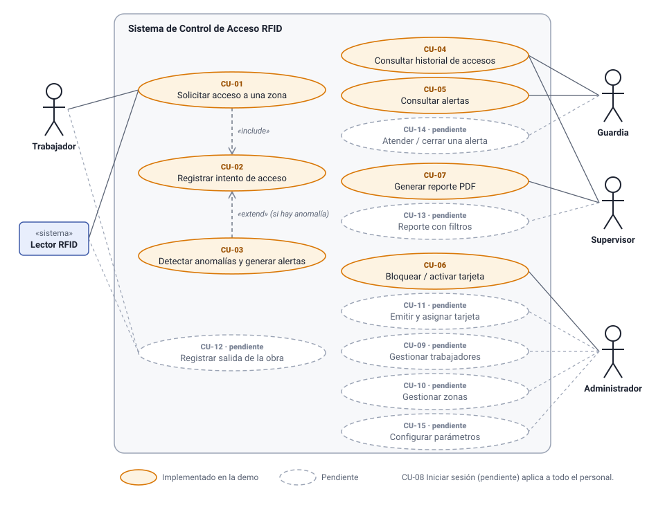

# Casos de uso: Control de Acceso RFID

Este documento describe **qué puede hacer cada actor con el sistema**, paso a paso, y se usa como referencia para desarrollar y probar.

- **CU-01 a CU-07** están **implementados** en la demo. Cada uno indica qué clases lo resuelven y qué tests lo comprueban.
- **CU-08 a CU-15** están **pendientes**. Se describen como propuesta, con lo que habría que cambiar en el código.

> Volver al [README](../README.md) · Ver la [documentación visual](https://jacojean07.github.io/Control-Acceso-RFID/)

---

## Índice

- [1. Actores](#1-actores)
- [2. Resumen de casos de uso](#2-resumen-de-casos-de-uso)
- [3. Reglas de negocio](#3-reglas-de-negocio)
- [4. Casos de uso implementados](#4-casos-de-uso-implementados)
  - [CU-01 Solicitar acceso a una zona](#cu-01-solicitar-acceso-a-una-zona)
  - [CU-02 Registrar intento de acceso](#cu-02-registrar-intento-de-acceso)
  - [CU-03 Detectar anomalías y generar alertas](#cu-03-detectar-anomalías-y-generar-alertas)
  - [CU-04 Consultar historial de accesos](#cu-04-consultar-historial-de-accesos)
  - [CU-05 Consultar alertas](#cu-05-consultar-alertas)
  - [CU-06 Bloquear / activar tarjeta](#cu-06-bloquear--activar-tarjeta)
  - [CU-07 Generar reporte PDF](#cu-07-generar-reporte-pdf)
- [5. Casos de uso pendientes](#5-casos-de-uso-pendientes)
- [6. Matriz de trazabilidad](#6-matriz-de-trazabilidad)

---

## 1. Actores

| Actor | Tipo | Descripción | En la demo |
|---|---|---|---|
| **Trabajador** | Persona (principal) | Quien pasa la tarjeta para entrar a una zona. | Se simula eligiendo la tarjeta en el combo. |
| **Lector RFID** | Sistema externo (secundario) | Dispositivo en la puerta de cada zona; lee el UID y lo envía al sistema. | `SimuladorLectorRFID` |
| **Guardia** | Persona | Vigila en tiempo real los accesos y las alertas. | Usa las pestañas Registros y Alertas. |
| **Supervisor** | Persona | Revisa el historial y genera reportes. | Usa Registros y el botón de PDF. |
| **Administrador** | Persona | Gestiona tarjetas, trabajadores, zonas y la configuración. | Usa la pestaña Tarjetas. |

> **Nota:** la demo **no tiene login** (CU-08), así que cualquier persona que abra la aplicación actúa a la vez como guardia, supervisor y administrador. La separación de actores sirve para el diseño y para cuando se implemente la autenticación.

---

## 2. Resumen de casos de uso

| ID | Caso de uso | Actor principal | Estado | Relación |
|---|---|---|---|---|
| CU-01 | Solicitar acceso a una zona | Trabajador, Lector RFID | ✅ Implementado | «include» CU-02 |
| CU-02 | Registrar intento de acceso | (sistema) | ✅ Implementado | Incluido por CU-01 |
| CU-03 | Detectar anomalías y generar alertas | (sistema) | ✅ Implementado | «extend» CU-02 |
| CU-04 | Consultar historial de accesos | Guardia, Supervisor | ✅ Implementado | |
| CU-05 | Consultar alertas | Guardia | ✅ Implementado | |
| CU-06 | Bloquear / activar tarjeta | Administrador | ✅ Implementado | |
| CU-07 | Generar reporte PDF | Supervisor | ✅ Implementado | |
| CU-08 | Iniciar sesión | Guardia, Supervisor, Administrador | ⏳ Pendiente | Precondición del resto |
| CU-09 | Gestionar trabajadores | Administrador | ⏳ Pendiente | |
| CU-10 | Gestionar zonas | Administrador | ⏳ Pendiente | |
| CU-11 | Emitir y asignar tarjeta | Administrador | ⏳ Pendiente | |
| CU-12 | Registrar salida de la obra | Trabajador, Lector RFID | ⏳ Pendiente | «include» CU-02 |
| CU-13 | Generar reporte con filtros | Supervisor | ⏳ Pendiente | Extiende CU-07 |
| CU-14 | Atender / cerrar una alerta | Guardia | ⏳ Pendiente | |
| CU-15 | Configurar parámetros | Administrador | ⏳ Pendiente | |

---

## 3. Reglas de negocio

Los casos de uso hacen referencia a estas reglas por su código (RN-xx).

| Código | Regla | Dónde se aplica |
|---|---|---|
| **RN-01** | Un trabajador puede entrar a una zona si su nivel es **igual o mayor** al nivel requerido. Orden: Básico < Restringido < Crítico. | `Nivel.alcanza()`, `Trabajador.puedeIngresarA()` |
| **RN-02** | Una tarjeta **no registrada** nunca da acceso. | `ControlAccesoService.evaluar()` |
| **RN-03** | Una tarjeta **bloqueada** nunca da acceso. | `ControlAccesoService.evaluar()` |
| **RN-04** | Las reglas se revisan en orden (existe → activa → nivel) y **el primer "no" decide** el motivo del rechazo. | `ControlAccesoService.evaluar()` |
| **RN-05** | **Todo intento se registra**, permitido o no, incluso con tarjetas desconocidas. | `ControlAccesoService.procesarLectura()` |
| **RN-06** | El UID de la tarjeta **nunca se guarda**; solo el SHA-256 del UID normalizado (mayúsculas, solo hexadecimal). | `CriptoService` |
| **RN-07** | Si una tarjeta acumula **3 o más accesos denegados en 5 minutos**, se genera la alerta `INTENTOS_REPETIDOS`. | `DetectorAnomalias`, `AppConfig` |
| **RN-08** | Un acceso **permitido fuera de 06:00–20:00** se deja pasar, pero genera la alerta `FUERA_DE_HORARIO`. | `DetectorAnomalias`, `AppConfig` |
| **RN-09** | Usar una tarjeta desconocida o bloqueada genera la alerta correspondiente (`TARJETA_DESCONOCIDA` / `TARJETA_INACTIVA`). | `DetectorAnomalias` |

---

## 4. Casos de uso implementados

### CU-01 Solicitar acceso a una zona

| | |
|---|---|
| **Actores** | Trabajador (principal), Lector RFID (secundario) |
| **Objetivo** | Que el trabajador entre a una zona si tiene permiso. |
| **Disparador** | El trabajador acerca su tarjeta al lector de la puerta. |
| **Precondiciones** | La zona existe en el sistema. El lector de esa zona está funcionando. |
| **Postcondiciones** | Queda un registro del intento (CU-02) y, si corresponde, alertas (CU-03). El trabajador ve si puede pasar. |
| **Reglas** | RN-01, RN-02, RN-03, RN-04, RN-06 |

**Flujo principal (acceso permitido)**

1. El trabajador acerca su tarjeta al lector de la zona.
2. El lector lee el UID y envía una `LecturaRFID` (UID, código de zona, fecha y hora).
3. El sistema busca la zona por su código.
4. El sistema calcula el hash del UID (RN-06).
5. El sistema busca la tarjeta por ese hash y obtiene a su titular.
6. El sistema verifica que la tarjeta esté activa.
7. El sistema verifica que el nivel del trabajador alcance el de la zona (RN-01).
8. El resultado es **PERMITIDO**.
9. Se **incluye CU-02** (registrar el intento).
10. Se muestra "PERMITIDO – *nombre* → *zona*" en verde.

**Flujos alternativos**

| Paso | Condición | Qué pasa |
|---|---|---|
| 3a | La zona no existe | Se muestra un error. **No** se registra nada. |
| 4a | El UID no tiene ningún carácter hexadecimal | Se muestra el error "UID inválido". No se registra. |
| 5a | No hay tarjeta con ese hash | Resultado `DENEGADO_TARJETA_DESCONOCIDA` (RN-02). Sigue en el paso 9 y se muestra en rojo. |
| 6a | La tarjeta está bloqueada | Resultado `DENEGADO_TARJETA_INACTIVA` (RN-03). Sigue en el paso 9. |
| 7a | El nivel no alcanza | Resultado `DENEGADO_NIVEL_INSUFICIENTE`. Sigue en el paso 9. |

**Implementación:** `ControlAccesoService.procesarLectura()` y `evaluar()`, `CriptoService.hashUid()`, `Trabajador.puedeIngresarA()`, `Nivel.alcanza()`, `SimuladorLectorRFID.simularLectura()`, `VentanaPrincipal.pasarTarjeta()` / `mostrarResultado()`, `ConsolaApp.pasarTarjeta()`.

**Tests:** `permiteAccesoConNivelSuficiente`, `aceptaElUidEnCualquierFormato`, `niegaAccesoConNivelInsuficiente`, `tarjetaDesconocidaSeNiegaYGeneraAlerta`, `tarjetaBloqueadaSeNiega`, `zonaInexistenteLanzaExcepcion`.

**Cómo probarlo en la demo:** escenarios 1, 2, 4 y 5 del guion del README.

---

### CU-02 Registrar intento de acceso

| | |
|---|---|
| **Actores** | Ninguno directo: lo ejecuta el sistema dentro de CU-01. |
| **Objetivo** | Dejar constancia de cada intento para auditoría y para detectar anomalías. |
| **Precondiciones** | CU-01 ya decidió el resultado. |
| **Postcondiciones** | Existe una fila nueva en `registro_acceso` con su id. |
| **Reglas** | RN-05, RN-06 |

**Flujo principal**

1. El sistema arma un `RegistroAcceso` con: hash del UID, id de la tarjeta (vacío si es desconocida), id de la zona, fecha y hora, y resultado.
2. El sistema lo guarda en la base de datos.
3. La base de datos devuelve el id generado y el sistema lo asigna al registro.
4. Si se cumple alguna condición de anomalía, se **extiende con CU-03**.

**Flujos alternativos**

| Paso | Condición | Qué pasa |
|---|---|---|
| 2a | Falla la base de datos | Se lanza `DatosAccesoException` y la lectura no se completa. |

**Implementación:** `RegistroRepository.guardar()` → `JdbcRegistroRepository.guardar()`, `RegistroAcceso.conId()`.

**Tests:** cubierto indirectamente por todos los tests de `ControlAccesoServiceTest` y por `elHistorialMuestraNombresYDesconocidos`.

---

### CU-03 Detectar anomalías y generar alertas

| | |
|---|---|
| **Actores** | Ninguno directo: lo ejecuta el sistema. Las alertas las ve el Guardia (CU-05). |
| **Objetivo** | Avisar de situaciones sospechosas aunque no siempre impliquen negar el acceso. |
| **Precondiciones** | El registro ya está guardado (CU-02) y tiene id. |
| **Postcondiciones** | Hay cero o más filas nuevas en `alerta`, enlazadas al registro. |
| **Reglas** | RN-07, RN-08, RN-09 |

**Flujo principal**

1. El sistema analiza el registro recién guardado.
2. Si el resultado es tarjeta desconocida, crea la alerta `TARJETA_DESCONOCIDA`.
3. Si el resultado es tarjeta bloqueada, crea la alerta `TARJETA_INACTIVA`.
4. Si el acceso fue denegado, cuenta los denegados de ese hash en los últimos 5 minutos. Si son 3 o más, crea la alerta `INTENTOS_REPETIDOS`.
5. Si el acceso fue permitido y la hora está fuera de la jornada, crea la alerta `FUERA_DE_HORARIO`.
6. El sistema guarda cada alerta y la devuelve junto con el resultado, para que la UI muestre "N alerta(s)".

> Un mismo intento puede generar **más de una alerta** (por ejemplo, tarjeta desconocida e intentos repetidos).

**Implementación:** `DetectorAnomalias.analizar()` (decide), `ControlAccesoService.procesarLectura()` (guarda), `AlertaRepository.guardar()`, `RegistroRepository.contarDenegadosDesde()`.

**Tests:** `tarjetaDesconocidaSeNiegaYGeneraAlerta`, `tarjetaBloqueadaSeNiega`, `tresIntentosFallidosGeneranAlertaDeIntentosRepetidos`, `accesoNocturnoSePermitePeroGeneraAlerta`.

**Cómo probarlo en la demo:** escenarios 3, 4, 5 y 6 del guion.

---

### CU-04 Consultar historial de accesos

| | |
|---|---|
| **Actores** | Guardia, Supervisor |
| **Objetivo** | Ver quién intentó entrar, dónde, cuándo y con qué resultado. |
| **Precondiciones** | Ninguna (en la demo no hay login). |
| **Postcondiciones** | Ninguna: es solo una consulta. |

**Flujo principal**

1. El actor abre la pestaña **Registros de acceso** (en consola, la opción 2).
2. El sistema obtiene los últimos registros (200 en la ventana, 20 en la consola).
3. El sistema reemplaza los ids por nombres de zona y de trabajador.
4. El sistema muestra la tabla del más nuevo al más viejo, con el resultado en verde (permitido) o rojo (denegado).
5. La tabla se actualiza sola después de cada lectura.

**Flujos alternativos**

| Paso | Condición | Qué pasa |
|---|---|---|
| 2a | No hay registros | Tabla vacía (consola: "(sin registros)"). |
| 3a | El registro es de una tarjeta desconocida | En la columna Trabajador aparece "Desconocido". |

**Implementación:** `ReporteService.registrosDetallados()`, `VentanaPrincipal.refrescarTablas()`, `ConsolaApp.verRegistros()`.

**Tests:** `elHistorialMuestraNombresYDesconocidos`.

---

### CU-05 Consultar alertas

| | |
|---|---|
| **Actores** | Guardia |
| **Objetivo** | Revisar las anomalías detectadas. |
| **Precondiciones** | Ninguna. |
| **Postcondiciones** | Ninguna: es solo una consulta. |

**Flujo principal**

1. El guardia abre la pestaña **Alertas** (en consola, la opción 3).
2. El sistema muestra las últimas alertas con fecha y hora, tipo y detalle, de la más nueva a la más vieja.

**Flujos alternativos:** si no hay alertas, la tabla queda vacía (consola: "(sin alertas)").

**Implementación:** `ReporteService.alertasRecientes()`, `AlertaRepository.listarRecientes()`.

> **Pendiente relacionado:** marcar alertas como atendidas (CU-14).

---

### CU-06 Bloquear / activar tarjeta

| | |
|---|---|
| **Actores** | Administrador |
| **Objetivo** | Impedir (o volver a permitir) el uso de una tarjeta, por ejemplo cuando se pierde. |
| **Precondiciones** | La tarjeta existe. |
| **Postcondiciones** | El nuevo estado queda guardado y las siguientes lecturas lo respetan (RN-03). |

**Flujo principal**

1. El administrador abre la pestaña **Tarjetas**.
2. El sistema lista las tarjetas con el inicio del hash, el titular, el estado y la fecha de emisión.
3. El administrador selecciona una tarjeta y presiona **"Bloquear / activar tarjeta seleccionada"**.
4. El sistema cambia el estado (activa ↔ bloqueada) y lo guarda.
5. El sistema refresca la tabla y mantiene la fila seleccionada.

**Flujos alternativos**

| Paso | Condición | Qué pasa |
|---|---|---|
| 3a | No se seleccionó ninguna fila | Mensaje "Seleccione una tarjeta de la tabla." |

> Solo está disponible en la ventana, no en la consola.

**Implementación:** `ControlAccesoService.alternarEstadoTarjeta()`, `TarjetaRFID.bloquear()` / `activar()`, `TarjetaRepository.actualizarEstado()`, `VentanaPrincipal.alternarTarjetaSeleccionada()`.

**Tests:** `bloquearUnaTarjetaImpideElAcceso`.

**Cómo probarlo en la demo:** escenario 7 del guion.

---

### CU-07 Generar reporte PDF

| | |
|---|---|
| **Actores** | Supervisor (también Administrador) |
| **Objetivo** | Obtener un documento con los accesos y las alertas para archivar o entregar. |
| **Precondiciones** | Ninguna (el reporte puede salir vacío). |
| **Postcondiciones** | Existe `reportes/reporte-AAAAMMDD-HHMMSS.pdf`. |

**Flujo principal**

1. El supervisor presiona **"Generar reporte PDF"** (en consola, la opción 4).
2. El sistema reúne los últimos 500 registros (con nombres) y las últimas 500 alertas.
3. El sistema arma un `DatosReporte` con el título, la fecha de generación, los registros y las alertas.
4. El generador configurado (hoy `PdfReporteGenerator`) escribe el archivo en la carpeta `reportes/`. Si la carpeta no existe, la crea.
5. El sistema muestra la ruta del archivo y lo abre con el visor del sistema, si hay uno disponible.

**Flujos alternativos**

| Paso | Condición | Qué pasa |
|---|---|---|
| 4a | No se puede escribir el archivo | Se muestra un mensaje de error. |
| 5a | El sistema no puede abrir archivos (por ejemplo, un servidor) | Solo se muestra la ruta. |

**Implementación:** `ReporteService.generarReporte()`, `ReporteGenerator` (interfaz), `PdfReporteGenerator`, `DatosReporte`, `FilaRegistro`.

**Tests:** `PdfReporteGeneratorTest.generaUnPdfValido`.

---

## 5. Casos de uso pendientes

Propuestas para las siguientes iteraciones. El número entre paréntesis indica la **pregunta abierta** del README que conviene resolver antes.

### CU-08 Iniciar sesión (pregunta 9)

- **Actores:** Guardia, Supervisor, Administrador.
- **Flujo propuesto:** al abrir la aplicación aparece un diálogo de login. El usuario ingresa su usuario y contraseña, el sistema los valida y, según el rol, habilita o esconde acciones: el guardia solo consulta, el supervisor además genera reportes y el administrador puede todo.
- **Alternos:** credenciales incorrectas → mensaje de error; después de N intentos, bloqueo temporal.
- **Cambios necesarios:**
  - Tabla `usuario` (usuario, hash de la clave con BCrypt o PBKDF2, rol).
  - Enum `RolSistema`.
  - `UsuarioRepository` y `AutenticacionService`.
  - `LoginDialog` en `ui`.
  - `VentanaPrincipal` recibe el usuario actual.

### CU-09 Gestionar trabajadores

- **Actor:** Administrador.
- **Flujo propuesto:** pestaña "Trabajadores" con una tabla y botones Nuevo / Editar / Dar de baja. El formulario pide cédula, nombre, rol y nivel.
- **Alternos:** cédula repetida o inválida → error de validación. Un trabajador con registros no se borra: se le da de **baja lógica** (`activo = false`) y sus tarjetas se bloquean.
- **Cambios necesarios:**
  - `guardar`, `actualizar` y `darDeBaja` en `TrabajadorRepository`.
  - Columna `activo` en `trabajador`.
  - `TrabajadorService` con las validaciones.
  - La nueva pestaña.
  - En CU-01, rechazar a los trabajadores inactivos (nuevo `Resultado`).

### CU-10 Gestionar zonas

- **Actor:** Administrador.
- **Flujo propuesto:** crear y editar zonas (código único, nombre, nivel requerido y, a futuro, horario propio).
- **Alternos:** código repetido → error. Una zona con registros no se borra; se desactiva.
- **Cambios necesarios:** `guardar` y `actualizar` en `ZonaRepository`, `ZonaService` y una pestaña nueva.

### CU-11 Emitir y asignar tarjeta

- **Actor:** Administrador (con el Lector RFID de enrolamiento).
- **Flujo propuesto:**
  1. El administrador elige un trabajador y presiona "Asignar tarjeta".
  2. Acerca la tarjeta nueva al lector, o escribe el UID.
  3. El sistema calcula el hash, verifica que no exista y crea la tarjeta activa.
  4. Si el trabajador ya tenía una tarjeta activa, ofrece bloquearla.
- **Alternos:** la tarjeta ya está asignada a otra persona → error.
- **Cambios necesarios:** `TarjetaRepository.guardar()`, `TarjetaService` y un diálogo de asignación.

### CU-12 Registrar salida de la obra (pregunta 7)

- **Actores:** Trabajador, Lector RFID.
- **Flujo propuesto:** igual que CU-01, pero en un lector de salida. La salida siempre se permite y se registra con el sentido `SALIDA`. Habilita una vista **"Personas dentro ahora"**: quienes tienen una entrada sin salida posterior.
- **Alternos:** salida sin entrada previa → se registra y genera la alerta `SALIDA_SIN_ENTRADA`.
- **Cambios necesarios:**
  - Enum `Sentido` (ENTRADA / SALIDA).
  - Columna `sentido` en `registro_acceso`.
  - Campo en `LecturaRFID` y lectores configurados por sentido.
  - Una consulta de presentes.

### CU-13 Generar reporte con filtros (pregunta 10)

- **Actor:** Supervisor.
- **Flujo propuesto:** antes de generar el reporte, el supervisor elige un rango de fechas y, opcionalmente, trabajador, zona y resultado. El sistema filtra y genera el PDF (o CSV).
- **Cambios necesarios:**
  - Record `FiltroRegistro`.
  - `RegistroRepository.buscar(FiltroRegistro)`.
  - Un diálogo de filtros.
  - `CsvReporteGenerator` como segundo formato.

### CU-14 Atender / cerrar una alerta

- **Actor:** Guardia.
- **Flujo propuesto:** el guardia selecciona una alerta pendiente, escribe un comentario ("era un visitante autorizado") y la marca como atendida. Las alertas pendientes se destacan en la UI.
- **Cambios necesarios:**
  - Columnas `estado`, `atendida_por`, `atendida_en` y `comentario` en `alerta`.
  - `AlertaRepository.marcarAtendida()`.
  - Un filtro de "solo pendientes".

### CU-15 Configurar parámetros (pregunta 6)

- **Actor:** Administrador.
- **Flujo propuesto:** pantalla para cambiar el horario laboral, el umbral de intentos y la ventana de tiempo, sin recompilar.
- **Cambios necesarios:**
  - Mover las constantes de `AppConfig` a `application.properties` o a una tabla `configuracion`.
  - Clase `Configuracion` que se inyecta en `DetectorAnomalias`.

---

## 6. Matriz de trazabilidad

Qué clases participan en cada caso de uso implementado (✔ = participa).

| Clase | CU-01 | CU-02 | CU-03 | CU-04 | CU-05 | CU-06 | CU-07 |
|---|:-:|:-:|:-:|:-:|:-:|:-:|:-:|
| `SimuladorLectorRFID` / `LectorRFID` | ✔ | | | | | | |
| `ControlAccesoService` | ✔ | ✔ | ✔ | | | ✔ | |
| `CriptoService` | ✔ | | | | | | |
| `DetectorAnomalias` | | | ✔ | | | | |
| `ReporteService` | | | | ✔ | ✔ | | ✔ |
| `PdfReporteGenerator` | | | | | | | ✔ |
| `TarjetaRepository` | ✔ | | | ✔ | | ✔ | ✔ |
| `TrabajadorRepository` | ✔ | | | ✔ | | | ✔ |
| `ZonaRepository` | ✔ | | | ✔ | | | ✔ |
| `RegistroRepository` | | ✔ | ✔ | ✔ | | | ✔ |
| `AlertaRepository` | | | ✔ | | ✔ | | ✔ |
| `VentanaPrincipal` / `ConsolaApp` | ✔ | | | ✔ | ✔ | ✔¹ | ✔ |

¹ Solo en `VentanaPrincipal`.
